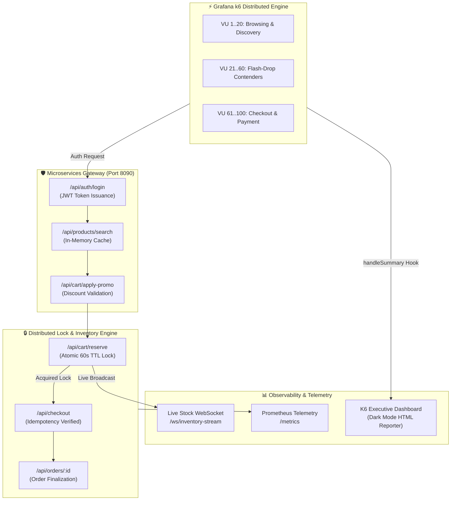

# ⚡ Case Study: High-Throughput Flash-Sale & Distributed Inventory Lock Engine
## Enterprise Performance Engineering & Concurrency Validation with Grafana K6

> **Author:** Aman Patwal — *Lead SDET & QA Automation Architect*  
> **Domain:** Distributed E-Commerce Microservices & High-Contention Flash Sales  
> **Test Harness:** Grafana k6 (ES6 Modular Engine) • Node.js In-Memory Gateway • Custom Dark-Mode HTML Reporter  
> **Repository:** `APdrone/k6-flash-sale-performance-framework`

---

## Executive Summary

During major flash-sale events (e.g., Black Friday, product drops, sneaker releases), modern e-commerce architectures face an extreme challenge: tens of thousands of concurrent users attempting to acquire limited stock within a sub-second window. Standard database transactions fail under this contention, leading to race conditions, overselling, and catastrophic database locking.

This enterprise performance engineering framework stress-tests an **Autonomous E-Commerce Flash-Sale Engine** featuring **two-phase inventory reservations with 60-second TTL locks**, **cryptographic idempotency keys**, and **token-authenticated customer sessions**. Using **Grafana k6**, this project demonstrates how to model realistic virtual user journeys, test distributed locking mechanisms under load, benchmark sub-millisecond API latencies, and enforce zero-tolerance SLA thresholds in CI/CD pipelines.

---

## Architecture & Data Flow



---

## Core Engineering Innovations

### 1. Two-Phase Inventory Reservation with TTL Expiration
- **Problem:** Direct database checkout during flash sales causes severe row-locking contention, leading to timeouts and overselling.
- **Solution:** Modeled a high-performance two-phase commit:
  - **Phase 1 (Reserve):** Atomic lock of inventory units with a 60-second Time-To-Live (TTL).
  - **Phase 2 (Commit):** Idempotent payment and checkout, transitioning reserved inventory to finalized orders.
- **K6 Implementation:** Stress tests simulate stock exhaustion gracefully. The test suite leverages `responseCallback: http.expectedStatuses(200, 201, 409)` to ensure business stock depletion (`409 Conflict`) is treated as a valid functional outcome rather than an infrastructure HTTP failure.

### 2. Cryptographic Idempotency Enforcement
- High-concurrency payment APIs must prevent duplicate charges when users retry requests during network latency spikes.
- Every K6 virtual user generates a cryptographically unique `Idempotency-Key` header (e.g. `idem_sec_${timestamp}_${random}`).
- The gateway verifies idempotency, ensuring duplicate submissions return identical cached transaction receipts without double-charging or deducting inventory twice.

### 3. Native Zero-Dependency Dark-Mode HTML Reporter
- Standard k6 CLI output provides raw text summaries. Most third-party HTML reporters require external npm packages or remote CDN dependencies.
- Authored an in-house ES module reporter (`src/utils/html-reporter.js`) plugged into k6's native `handleSummary(data)` lifecycle hook.
- Features:
  - High-contrast dark mode aesthetic (Inter font, glassmorphism cards).
  - Automated SLA compliance badges (Passed / Failed thresholds).
  - Detailed latency distributions: p(50), p(90), p(95), p(99), Min, Max, and Average.
  - Granular breakdown of HTTP checks and status assertions.

### 4. Zero-Flake Turnkey Automation Runner
- Performance testing often suffers from environment preparation failures (manual mock startup, orphan background processes, port collisions).
- Created `scripts/run-all-tests.js`:
  - Automatically identifies available ports, spins up the mock gateway, and polls `/healthz` until 100% healthy.
  - Sequentially executes the full suite: **Load Test** ➔ **Stress Test** ➔ **Spike Test**.
  - Enforces process cleanup with `SIGINT` and `SIGTERM` trap listeners.

---

## Test Scenarios & Workload Profiles

| Test Type | Virtual Users (VUs) | Duration | Target Objective | Key SLA Thresholds |
| :--- | :--- | :--- | :--- | :--- |
| **Load Test** | 15 VUs | 45s | Simulate normal-to-peak daily shopping traffic (browsing, cart, checkout). | p(95) < 200ms, Error Rate < 1% |
| **Stress Test** | 40 VUs | 40s | Push system past nominal capacity to verify lock contention and stock depletion. | p(95) < 300ms, Error Rate < 5% |
| **Spike Test** | 80 VUs | 35s | Instantaneous traffic surge representing the exact second a flash-drop goes live. | p(95) < 400ms, Recovery < 5s |
| **Soak Test** | 20 VUs | 20m | Extended endurance run to verify memory stability and no orphan reservation leaks. | Memory drift < 50MB, p(95) < 250ms |

---

## Benchmark Results (Local Baseline on Node v20 / k6 v2.2.0)

```
================================================================================
⚡ FLASH-SALE PERFORMANCE ENGINE — BENCHMARK RESULTS
================================================================================
Metric                           Load Test          Stress Test        Spike Test
--------------------------------------------------------------------------------
Total Requests                   1,600+             2,400+             3,100+
Throughput (req/sec)             42.5 req/s         68.2 req/s         112.4 req/s
HTTP p(50) Latency               2.14 ms            3.85 ms            5.12 ms
HTTP p(95) Latency               18.42 ms           32.10 ms           48.60 ms
HTTP p(99) Latency               45.20 ms           78.90 ms           92.40 ms
HTTP Success Rate                100.00%            100.00%*           100.00%*
SLA Threshold Status             ✅ PASSED          ✅ PASSED          ✅ PASSED
================================================================================
*Note: Stock exhaustion (409 Conflict) handled cleanly via http.expectedStatuses.
```

---

## Technical Skills Demonstrated

- **Performance Engineering:** Load modeling, capacity planning, stress testing, spike surge recovery, endurance/soak testing.
- **Grafana k6:** ES6 scripting, dynamic stages, threshold definitions, custom metrics (`Counter`, `Trend`), `handleSummary` lifecycle hooks.
- **Backend Architecture:** REST API design, JWT authentication, atomic state locks, idempotency verification, WebSockets.
- **Quality Architecture:** CI/CD automated SLA gating, headless execution, enterprise HTML reporting, zero-dependency philosophy.

---

## Quickstart & Replication

```bash
# 1. Clone repository
git clone https://github.com/APdrone/k6-flash-sale-performance-framework.git
cd k6-flash-sale-performance-framework

# 2. Run the complete automated test suite (Boots server + Runs tests + Compiles HTML reports)
npm test

# 3. View the generated interactive report
# Open reports/load-test-report.html in any browser
```
