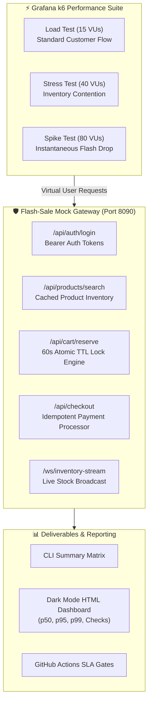

# ⚡ Enterprise Flash-Sale Performance Testing Framework
### High-Concurrency Grafana k6 Test Engine with Distributed Inventory Locking & Executive Reporting

[](https://k6.io/)
[](https://nodejs.org/)
[-brightgreen?style=for-the-badge)](https://github.com/APdrone/k6-flash-sale-performance-framework)
[](https://github.com/APdrone/k6-flash-sale-performance-framework)
[](https://opensource.org/licenses/MIT)

> Built by **[Aman Patwal](https://github.com/APdrone)** — *Lead SDET & QA Automation Architect*  
> Demonstrating production-grade load, stress, spike, and soak testing against high-contention e-commerce microservices.

---

## 🎯 Overview

High-volume flash sales represent one of the most volatile scenarios in distributed computing. When thousands of shoppers target the same inventory SKU within seconds, traditional architectures face lock contention, overselling, and cascading service outages.

This repository provides an enterprise-ready **Grafana k6 Performance Engineering Framework** designed to validate:
1. **High-Concurrency Flash-Drop Surges:** Simulating immediate spikes from 0 to 80+ Virtual Users (VUs).
2. **Two-Phase Inventory Reservation Engine:** Validating 60-second atomic TTL reservation locks and graceful `409 Conflict` handling.
3. **Cryptographic Idempotent Checkouts:** Ensuring duplicate requests do not produce double orders or double inventory deductions.
4. **Autonomous Testing Pipeline:** Featuring a standalone in-memory Flash-Sale Mock Gateway (Port 8090) with zero external database dependencies.
5. **Interactive Executive Dashboards:** Native zero-dependency dark-mode HTML reports generated via k6's `handleSummary` hook.

---

## 📐 System Architecture



---

## 🚀 Key Framework Features

- **Multi-Phase Scenarios:** Modular K6 scripts modeling full real-world customer journeys (Authentication ➔ Product Discovery ➔ Promo Code Application ➔ Stock Reservation ➔ Idempotent Checkout).
- **Atomic Concurrency Handling:** Sophisticated assertion logic using K6's `responseCallback: http.expectedStatuses(200, 201, 409)` to differentiate business stock depletion from infrastructure errors.
- **Enterprise SLA Thresholds:** Strict gating ensuring:
  - `http_req_duration`: `p(95) < 200ms`, `p(99) < 350ms`
  - `http_req_failed`: `< 1%`
  - `checks`: `> 99%` pass rate
- **Zero-Dependency Executive HTML Dashboard:** Beautiful dark-mode report with interactive latency distributions, SLA metric cards, and check validations.
- **Autonomous Lifecycle Runner:** Single-command execution that launches the mock server, waits for the healthcheck, executes tests sequentially, and cleans up background processes.

---

## 📂 Repository Structure

```
k6-flash-sale-performance-framework/
├── .github/
│   └── workflows/
│       └── k6-performance.yml          # GitHub Actions CI/CD Pipeline
├── config/
│   ├── environments/                   # Target Environment Configurations
│   │   ├── dev.js                      # Local development gateway config
│   │   ├── staging.js                  # Staging cluster configuration
│   │   └── production.js               # Production baseline configuration
│   └── thresholds/                     # Strict SLA Performance Budgets
│       ├── load-thresholds.js          # p95 < 200ms, error < 1%
│       ├── stress-thresholds.js        # p95 < 300ms, error < 5%
│       ├── spike-thresholds.js         # p95 < 400ms, error < 5%
│       └── soak-thresholds.js          # p95 < 250ms, endurance gating
├── reports/                            # Generated HTML & JSON Reports
│   ├── load-test-report.html           # Dark-mode Load Test Dashboard
│   ├── stress-test-report.html         # Dark-mode Stress Test Dashboard
│   └── spike-test-report.html          # Dark-mode Spike Test Dashboard
├── scripts/
│   └── run-all-tests.js                # Turnkey orchestration runner
├── src/
│   ├── server/
│   │   └── mock-server.js              # High-concurrency Flash-Sale Gateway
│   └── utils/
│       ├── data-utils.js               # Dynamic test data & UUID helpers
│       └── html-reporter.js            # Standalone k6 HTML dashboard generator
├── tests/
│   ├── load/
│   │   └── load-test.js                # Normal-to-peak customer load scenario
│   ├── stress/
│   │   └── stress-test.js              # High-contention stock exhaustion scenario
│   ├── spike/
│   │   └── spike-test.js               # Instant flash-drop traffic surge
│   └── soak/
│       └── soak-test.js                # Extended endurance leak detection
├── package.json                        # Orchestration scripts and metadata
├── PORTFOLIO_CASE_STUDY.md             # In-depth architectural case study
└── README.md                           # Documentation & quickstart guide
```

---

## 🛠️ Prerequisites

- **[Grafana k6](https://k6.io/docs/get-started/installation/)** (v0.49.0 or higher)
  ```bash
  # Windows (Winget)
  winget install k6 --source winget

  # macOS (Homebrew)
  brew install k6
  ```
- **Node.js** (v18.0.0 or higher)

---

## ⚡ Quickstart

### 1. Run Complete Test Suite (Recommended)
This runs the autonomous orchestrator: starts the mock gateway on port 8090, executes Load, Stress, and Spike tests, validates thresholds, and generates HTML reports.

```bash
npm test
```

### 2. Run Individual Test Scenarios

```bash
# Start the Mock Server in one terminal:
npm run mock:server

# In a second terminal, execute target scenario:
npm run test:load       # 15 VUs, 45s - Customer Journey
npm run test:stress     # 40 VUs, 40s - High Contention Stock Depletion
npm run test:spike      # 80 VUs, 35s - Sudden Traffic Surge
npm run test:soak       # 20 VUs, 20m - Endurance & Memory Leak Test
```

---

## 📊 Executive Reporting & Dashboards

Each test run executes the `handleSummary` hook in `src/utils/html-reporter.js`, generating a self-contained, offline-compatible HTML dashboard saved to `reports/`:

- **Executive KPI Cards:** Total Requests, Peak Throughput (RPS), Error Rate, Virtual Users.
- **Percentile Distributions:** Exact values for p(50), p(90), p(95), p(99), Min, and Max.
- **SLA Gate Status:** Visual indicators for each configured threshold (e.g. `http_req_duration: p(95) < 200ms`).
- **Check Assertions:** Full pass/fail breakdown of business logic checks (Auth 200, Stock Reserved 201, Idempotent Checkout 200).

---

## 🔄 CI/CD Pipeline Integration

A complete GitHub Actions workflow is included at `.github/workflows/k6-performance.yml`. It executes on every push and pull request:
1. Provisions Node.js and Grafana k6 runner environments.
2. Starts the Mock Gateway in background daemon mode.
3. Awaits successful health probe response on `http://localhost:8090/healthz`.
4. Executes test suites with threshold failure triggers (`--exit-code`).
5. Publishes HTML test dashboards as downloadable CI job artifacts.

---

## 👤 Author & Architecture Leadership

**Aman Patwal**  
*Lead SDET & QA Automation Architect*  
- **GitHub:** [@APdrone](https://github.com/APdrone)  
- **Specializations:** Enterprise Test Framework Architecture, Performance Engineering, Distributed Systems Reliability, CI/CD Quality Gates.

---

## 📄 License

This project is licensed under the MIT License — see the [LICENSE](LICENSE) file for details.
